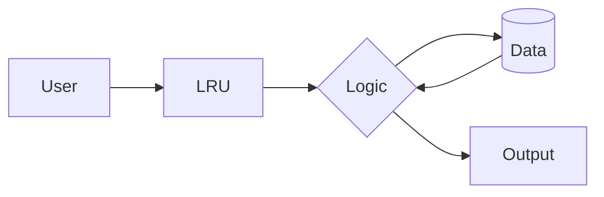
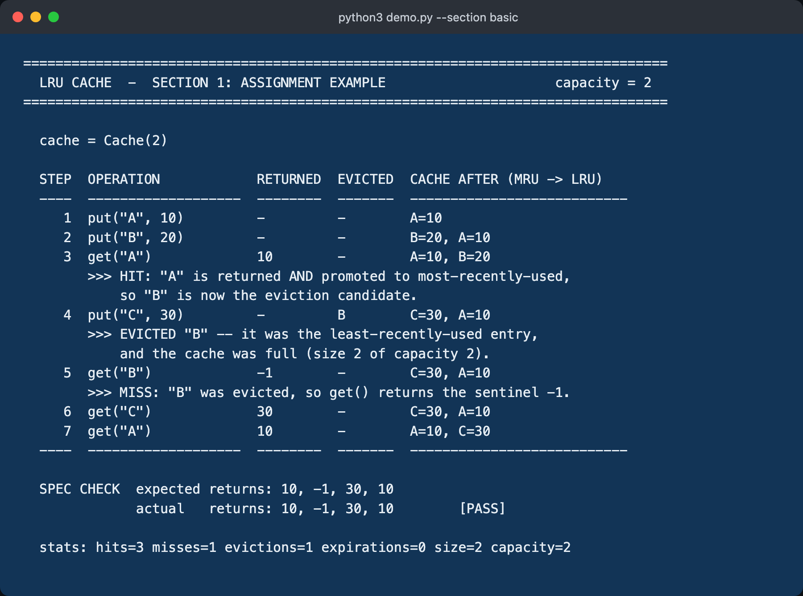
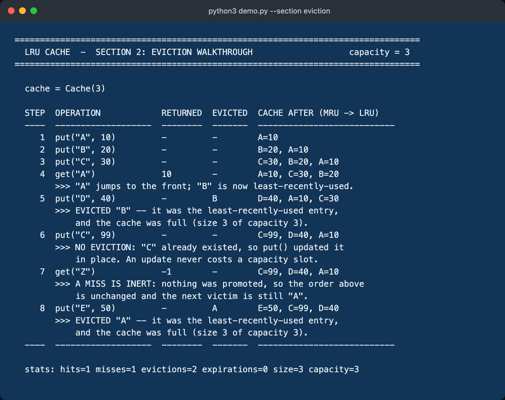
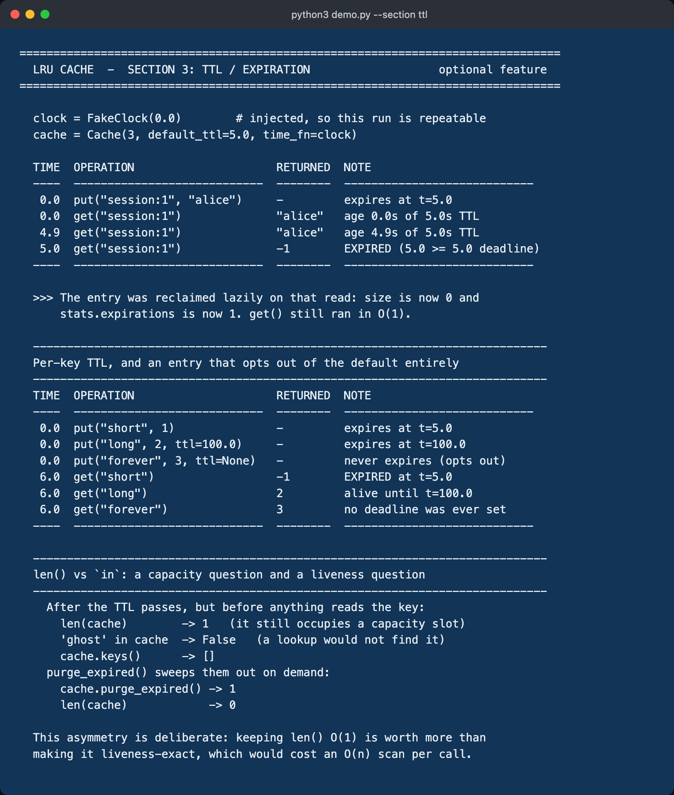
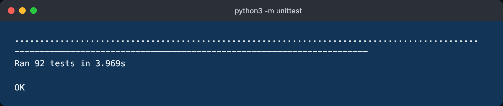

# LRU Cache

A Least Recently Used cache with `Cache(capacity)`, `get(key)` and
`put(key, value)`, built from a **hash map + doubly linked list** so that both
operations run in **O(1) amortised** time. Optional **TTL / expiration** is
included. Python 3.9+, standard library only — nothing to install.

## Architecture / How it Works




```python
from lru_cache import Cache

cache = Cache(2)
cache.put("A", 10)
cache.put("B", 20)
cache.get("A")      # -> 10   ("A" is now most-recently-used)
cache.put("C", 30)  #         cache was full -> evicts "B"
cache.get("B")      # -> -1   (miss)
cache.get("C")      # -> 30
cache.get("A")      # -> 10
```

---

## Quick start

No dependencies, no virtualenv, no build step:

```bash
python3 demo.py                    # the full demonstration (sections 1-3)
python3 demo.py --section basic    # just the assignment example
python3 demo.py --section ttl      # just the TTL / expiration demo
python3 -m unittest -v             # the test suite (92 tests)
```

Or through the Makefile:

```bash
make demo        # run the demonstration
make test        # run the test suite
make test-all    # run the suite on each Python 3.9+ found; fails if any fails
make verify      # tests + proof the captured logs match a live run
make shots       # regenerate photo/*.png from real runs
```

> Pillow is required **only** by `scripts/capture_screenshots.py`. The cache,
> the demo and the tests are pure standard library.

---

## Output screenshots

All four images were generated by `scripts/capture_screenshots.py`, which runs
the program and photographs its actual output. Nothing is hand-written or
edited — see [Are these screenshots real?](#are-these-screenshots-real) below
for the one-command proof.

### 1. The assignment example — put(), get(), eviction, returned values



Every graded element is visible in this one image: the `put()` calls, the
`get()` calls, the value each `get()` returned, the LRU eviction of `"B"` with
the reason it was chosen, and the `-1` returned for the evicted key. The
`CACHE AFTER (MRU -> LRU)` column makes the recency ordering visible on every
line — watch it flip at step 3, which is exactly why `"B"` is the victim at
step 4. The `SPEC CHECK ... [PASS]` line is computed at runtime, not printed
blindly: the demo asserts the four returned values equal `10, -1, 30, 10` and
crashes rather than printing `[PASS]` if they do not.

### 2. Eviction walkthrough — the cases that are easy to get wrong



Capacity 3, showing recency promotion by `get`, an update at full capacity that
correctly evicts **nothing**, and a failed `get` that correctly reorders
**nothing**.

### 3. TTL / expiration



An entry alive at t=4.9 and expired at t=5.0, per-key TTL overriding the
default, an entry opting out of expiry entirely, and `purge_expired()`.

### 4. Test suite



### Are these screenshots real?

Each `.png` ships next to the verbatim stdout it was rendered from. Re-run the
program and diff the log — no output means the shipped log matches a live run
byte for byte:

```bash
python3 demo.py --section basic | diff - photo/01_assignment_example.txt
```

A `diff` on its own only proves the *log* is real, so `make verify` goes
further. `scripts/verify_photos.py` re-runs every command, compares the output
to the shipped `.txt`, **and** re-hashes both the `.txt` and the `.png` against
`MANIFEST.json` — which is what catches a stale image left behind by an
interrupted `make shots`. The capture pipeline is also atomic: a `.txt` is
never written until its `.png` has been rendered and validated, so the two can
never come from different runs.

```bash
make verify    # tests + all four shots checked end to end
```

The fourth shot is the test suite, whose output embeds unittest's own timing
(`Ran 75 tests in 3.1s`), so it will never diff clean. Normalise that one line:

```bash
python3 -m unittest 2>&1 | sed 's/in [0-9.]*s/in Ns/' \
  | diff - <(sed 's/in [0-9.]*s/in Ns/' photo/04_unit_tests.txt)
```

`photo/MANIFEST.json` records, per shot, the command, the SHA-256 of the
captured stdout, the capture method, and the validator's pixel scores.

**How the images are made.** The pipeline runs each command once and keeps the
output in memory. Paths B and C photograph *that exact string*, so the image
cannot show text the program did not print. Path A is different: it re-runs the
command inside Terminal and photographs that second run, then compares the two
outputs and **refuses the image unless they match** (ignoring unittest's own
wall-clock duration). Either way, the shipped `.txt` is what the pixels show.
Three capture paths are tried in order:

| Path | What it is | Status on this machine |
|---|---|---|
| A | `screencapture` of a real Terminal.app window | unavailable — Screen Recording permission is not granted |
| B | headless Google Chrome rendering the captured output | **used for the images above** |
| C | Pillow drawing the captured output | available as a last resort |

Path A is preferred and is attempted first. macOS denies it here, and the
script detects that up front with a cheap 8×8 probe rather than opening a
window to find out. To get true Terminal screenshots instead, grant Screen
Recording under *System Settings → Privacy & Security → Screen & System Audio
Recording* to the app running the script, relaunch it, and re-run `make shots`.

Every path paints the same sentinel background `#123456` and every produced
image is validated on its pixels before it is accepted. That check exists
because of a specific macOS trap: when Screen Recording is denied, some
versions of `screencapture` **exit 0** and hand back the desktop wallpaper with
no windows in it. The exit code is not a usable signal; the pixels are.

---

## Project layout

| File | Purpose |
|---|---|
| `lru_cache.py` | The implementation. `LRUCache`, plus `Cache` alias, `CacheStats`, `FakeClock`. |
| `demo.py` | Runnable demonstration; renders its tables from real cache state. |
| `test_lru_cache.py` | 92 tests, standard library `unittest`. |
| `scripts/capture_screenshots.py` | Generates `photo/` from real runs. Needs Pillow. |
| `scripts/verify_photos.py` | Checks photo/ against live runs and manifest hashes. Stdlib only. |
| `photo/` | Screenshots, the verbatim logs behind them, and `MANIFEST.json`. |
| `ARCHITECTURE.md` | Invariants and the pointer surgery, step by step. |
| `TASK3.md` | The Task 3 short answers. |

---

## Data structures used

Two structures, each covering the other's weakness:

**1. A hash map (`dict`) from key to node.** Gives O(1) lookup. On its own it
is useless for LRU: a dict cannot tell you which entry was touched longest ago.

**2. A doubly linked list, most-recently-used first.** Gives O(1) reordering
and O(1) removal of the tail. On its own it is also useless: finding a key
means walking the list, which is O(n).

Used together, a lookup goes through the map and the reordering happens in the
list, so both operations stay O(1).

Three details that matter more than they look:

- **The list is doubly linked, not singly.** Removing a node needs its
  predecessor. A singly linked list would have to walk from the head to find
  it — O(n), which destroys the whole point.
- **Each node stores its own `key`, not just its value.** When we evict, we
  have the tail *node*; without the key on it we could not delete the
  corresponding map entry without searching the dict. This one field is what
  makes eviction O(1).
- **Two sentinel nodes** (`head` and `tail`) hold no data and are never
  removed. Without them, insert and remove each need four branches — empty
  list, first, last, middle. With them, there are zero:

  ```python
  def _unlink(self, node):
      node.prev.next = node.next     # node.prev always exists
      node.next.prev = node.prev     # node.next always exists
  ```

`_Node` uses `__slots__`, which removes the per-instance `__dict__`. At cache
scale that dict is the dominant memory cost per entry.

---

## How LRU ordering is maintained

The list runs most-recently-used to least-recently-used, bracketed by
sentinels:

```
   head <-> [MRU] <-> [ ... ] <-> [LRU] <-> tail
    ^                              ^
    |                              |
 never holds data           the eviction victim
                            is always tail.prev
```

One rule: **every successful access moves its node to the front, and the victim
is always `tail.prev`.**

Recency changes in exactly three places, and nowhere else:

| Trigger | What happens |
|---|---|
| a successful `get(key)` | `_move_to_front(node)` |
| `put(key, ...)` on an existing key | `_move_to_front(node)` |
| `put(key, ...)` of a new key | `_push_front(node)`, evicting `tail.prev` first if full |

Nothing else reorders the list. `peek`, `in`, `len`, `keys()`, `items()`,
`stats` and `repr()` are fully pure. A **failed** `get` leaves the ordering
untouched too — it still counts a miss, and on an expired entry it reclaims
the node (see the TTL matrix below), but it never promotes anything. A cache
miss must not disturb the order, and `test_failed_get_does_not_reorder` fails
if it ever does. `clear()` and `purge_expired()` restructure the list by
design.

Walking the assignment example, capacity 2:

| Step | Operation | Returns | List after (MRU → LRU) |
|---|---|---|---|
| 1 | `put("A", 10)` | — | `A` |
| 2 | `put("B", 20)` | — | `B, A` |
| 3 | `get("A")` | `10` | `A, B` ← the hit promoted `A`, so `B` is now the victim |
| 4 | `put("C", 30)` | — | `C, A` ← full, so `tail.prev` (`B`) is evicted |
| 5 | `get("B")` | `-1` | `C, A` ← miss, nothing moves |
| 6 | `get("C")` | `30` | `C, A` |
| 7 | `get("A")` | `10` | `A, C` |

**Insert when full** is the only path that can evict, which is precisely why
updating an existing key never does:

```python
node = self._map.get(key)
if node is not None:              # UPDATE -- already owns a slot, cannot overflow
    node.value = value
    self._move_to_front(node)
    return
if len(self._map) >= self._capacity:   # INSERT -- the only branch that evicts
    self._evict_lru()
```

---

## Complexity

### Time

| Operation | Average | Worst case | Why |
|---|---|---|---|
| `get(key)` | **O(1)** | O(n) | one dict lookup + a constant number of pointer writes |
| `put(key, value)` | **O(1)** | O(n) | dict lookup + at most one eviction, both O(1) |
| `peek(key)` | **O(1)** | O(n) | dict lookup only |
| `key in cache` | **O(1)** | O(n) | dict lookup only |
| `len(cache)` | O(1) | O(1) | `len` of the dict |
| `keys()` / `items()` | O(n) | O(n) | walks the list |
| `purge_expired()` | O(n) | O(n) | walks the list |
| `clear()` | O(n) | O(n) | must unlink every node so values are freed at once |

Two pieces of honesty behind the headline number:

- **The linked-list work is O(1) worst case.** Unlinking and re-inserting a
  node is a fixed number of pointer assignments, with no loop and no branch.
- **The dict work is O(1) *average*.** Hash collisions and occasional resizing
  give a worst case of O(n) for a single operation, amortised back to O(1)
  across a sequence. This is the standard hash-table caveat, and it is the only
  reason the headline claim says "amortised" rather than "worst case".
- With TTL enabled, a read may also reclaim **one** expired node. That unlink
  is charged to the entry's own insertion and happens at most once per entry,
  so the amortised bound still holds.

`demo.py --section perf` measures this empirically: per-operation cost stays
flat while capacity grows 100×.

### Space

**O(capacity)** — bounded by the capacity, never by how many distinct keys have
ever been inserted. Per resident entry:

- one `dict` entry (hash, key reference, value reference), and
- one `_Node` with five `__slots__` fields: `key`, `value`, `prev`, `next`,
  `expires_at`.

Plus two sentinel nodes for the whole cache, and nothing else. Note the key is
referenced twice — once by the dict, once by the node. That duplication is
deliberate: it is what buys O(1) eviction.

---

## TTL / expiration (optional feature)

Off by default. Enable it per cache, per key, or both:

```python
cache = Cache(100, default_ttl=60)      # everything expires after 60s
cache.put("a", 1)                       # inherits the 60s default
cache.put("b", 2, ttl=5)                # this one expires in 5s
cache.put("c", 3, ttl=None)             # this one never expires
cache.purge_expired()                   # optional sweep; returns how many went
```

**Approach: absolute deadlines + lazy expiration.**

Each node stores `expires_at`, an absolute deadline computed once at write
time, so the read path is a single float comparison. Nothing scans in the
background and there is no timer thread. An entry is discovered to be dead on
the first `get` that touches it, which is unlinked and dropped right there —
so `get` and `put` stay O(1).

**The clock is `time.monotonic`, not `time.time`.** Wall-clock can jump
backwards from an NTP correction or a manual change, which would resurrect
expired entries or kill live ones. A monotonic clock cannot. The clock is
injectable (`time_fn=`), which is how the tests and the TTL demo run
deterministically with no `sleep` — see `FakeClock`.

**The boundary is `>=`.** A ttl of `t` gives the half-open validity window
`[written, written + t)`, so an entry is dead at exactly its deadline.
Arbitrary, but chosen deliberately and pinned by
`test_entry_expires_exactly_at_boundary`.

**What each operation does with an expired-but-not-yet-reclaimed entry:**

| Operation | Result | Changes recency? | Reclaims the node? |
|---|---|---|---|
| `get(k)` | returns the default (`-1`); counts a miss + an expiration | n/a | **yes** |
| `peek(k)` | returns the default | no | no — `peek` is pure |
| `k in cache` | `False` | no | no |
| `keys()` / `items()` | omitted | no | no |
| `len(cache)` | **counted** | no | no |
| `put(k, v)` | treated as an **update** of the existing node | moves to MRU | reuses it |
| `purge_expired()` | removed | no | yes |
| an insert needing room | dead entries at the **LRU end** are reclaimed first | no | yes |

Two of those deserve a defence:

- **`put` on an expired key is an update, not an insert.** The key is still
  resident, so it already owns a capacity slot; reusing the node cannot
  overflow the cache, and nothing is counted as an eviction.
- **`len()` counts expired entries while `in` reports `False` for them.** That
  asymmetry is intentional: `len` answers a *capacity* question ("what is
  occupying space right now") and `in` answers a *liveness* question ("what
  would a lookup find"). Making `len` liveness-exact would force an O(n) scan
  on every call. `purge_expired()` is there when you want an exact live count.

**Why not a min-heap of deadlines?** It would expire entries proactively, but
it makes `put` O(log n), needs lazy deletion anyway when a TTL is refreshed,
and adds a second structure to keep consistent with the list. For a cache whose
entire selling point is O(1), that is the wrong trade.

---

## Testing

```bash
python3 -m unittest -v                                  # all 92 tests
python3 -m unittest test_lru_cache.TestSpecExample -v   # just the spec example
make test-all                                           # each Python found
```

Verified green on **Python 3.9.6, 3.13.13 and 3.14.6** — `make test-all` runs
them and exits non-zero if any of them fails.

| Group | Covers |
|---|---|
| `TestConstruction` | capacity validation — `0`, negative, `2.0`, `True`, `None`, `"2"` |
| `TestSpecExample` | the assignment's exact sequence, asserted step by step |
| `TestBasicOperations` | miss values, `None` values, a stored `-1`, unhashable keys, `clear` |
| `TestEvictionAndRecency` | eviction order, promotion on hit, update-without-eviction, inert misses |
| `TestStats` | hit/miss counters, `hit_rate` including the zero-lookup case, counters surviving `clear()` |
| `TestTTL` | expiry boundary, per-key TTL, opt-out, lazy reclamation, `purge_expired` |
| `TestDifferentialAgainstReferenceModel` | randomised comparison against an independent `OrderedDict` oracle |
| `TestDifferentialWithTTL` | the same, against a TTL-aware oracle, with a randomly advancing clock |
| `TestPurity` | read-only operations move neither the ordering nor any counter |
| `TestPublicSurface` | the `Cache` alias, `MISS`, `default_ttl`, `stats`, `items`/`__iter__` |
| `TestScale` | 200,000 operations stay correct and bounded |
| `TestDemoContract` | the demo is deterministic, 80 columns wide, exits clean, and still matches the committed `photo/*.txt` goldens |

The one worth calling out is **`TestDifferentialAgainstReferenceModel`**. It
runs tens of thousands of random `get`/`put`/`peek` operations against a
separately written model built on `collections.OrderedDict`, across five
capacities and three seeds, and compares both the returned value and the full
MRU→LRU ordering after **every** operation. Hand-written tests find the cases
you thought of; this finds the ones you did not. The oracle itself is checked
against the spec example first, so a shared bug cannot pass silently, and any
failure prints its seed so it reproduces exactly.

The linked-list invariants from `ARCHITECTURE.md` are re-asserted throughout:
both traversal directions must agree, the map size must equal the node count,
and no node may escape the chain.

---

## Design decisions and trade-offs

- **Hand-written list rather than `OrderedDict`.** `OrderedDict.move_to_end`
  would be correct and shorter, but it hides the mechanism this exercise is
  about. `OrderedDict` earns its place as the test oracle instead.
- **`Cache` is an alias for `LRUCache`** so the demo output maps one-to-one
  onto the assignment text.
- **`capacity` rejects `bool` and `float`.** `bool` subclasses `int`, so
  `Cache(True)` would silently mean capacity 1; `Cache(2.7)` would silently
  truncate. Both are latent bugs, not conveniences. `TypeError` for a wrong
  type, `ValueError` for a wrong value.
- **`get` returns `-1` by default, but takes a `default` argument.** The spec
  wants `-1`; real callers can pass a unique sentinel.
- **An unhashable key raises `TypeError`** straight from the dict, and does so
  before anything is mutated, so the cache is never left half-updated.
- **Lazy expiry over eager expiry**, to keep `get`/`put` O(1).
- **No lock.** See below.

## Known limitations

- **Not thread-safe**, and the reason is sharper than usual: even `get` mutates
  the linked list, so a reader/writer lock does not help. Safe concurrent use
  needs full mutual exclusion on reads too. Adding a lock would also make the
  O(1) claim a statement about contention rather than about the data structure,
  so it is left to the caller.
- **`-1` is ambiguous when `-1` is a stored value.** The spec requires it. Use
  `cache.get(key, sentinel)` or `key in cache` to disambiguate.
- **No scan resistance.** A sequential pass longer than the cache evicts the
  entire hot working set — see `TASK3.md`. LRU-K, ARC, or an admission filter
  address this; plain LRU cannot.
- **Expired entries can hold their slot.** An insert reclaims dead entries
  from the LRU end before discarding a live one, and any `get` reclaims the
  entry it touches — but a corpse that was recently *accessed* sits near the
  MRU end, where nothing sweeps it, so a live entry gets discarded instead.
  Finding dead entries anywhere in the list would cost an O(n) scan per
  insert, which is the whole bound this cache exists to hold. Run
  `purge_expired()` periodically if the workload writes short-TTL keys.
- **No persistence, and no size-aware eviction.** Entries are counted, not
  weighed, so one huge value costs the same as one tiny one.

---

## Regenerating the screenshots

```bash
make shots                                        # try Terminal, fall back
python3 scripts/capture_screenshots.py --html-only # never touch Terminal
```

The Terminal path briefly takes focus while it captures — don't type during it.
It needs two macOS permissions, **Automation** (to drive Terminal) and
**Screen Recording** (to capture pixels), both under *System Settings → Privacy
& Security*. If either is missing the script says so and falls back
automatically, so `make shots` always produces images.

---

## Publishing to GitHub

This repository was deliberately left un-initialised — no commits were made.
To publish it yourself:

```bash
cd <path-to-this-repo>
git init
git add .
git commit -m "LRU cache: implementation, tests, demo, screenshots"
git branch -M main
git remote add origin https://github.com/<your-username>/<repo-name>.git
git push -u origin main
```

`photo/` is intentionally **not** in `.gitignore` — the screenshots and their
logs are part of the submission.
